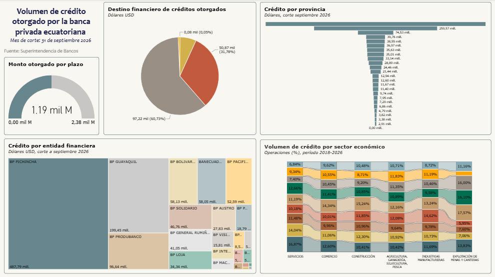

# Dashboard de Volumen de Crédito en Ecuador, corte al 31 de septiembre 2026

Dashboard sobre el volumen de crédito otorgado desde 2018, segmentado por provincia a nivel privado.



## Objetivo

Se revisó:
¿Cómo evolucionó el volumen de crédito desde 2018?
¿Qué provincias concentran el mayor volumen de crédito?
¿Qué cobertura de crédito recibió cada sector económico?

## Fuente de datos

- **Fuente:** Superintendencia de Bancos
- **Enlace:** https://www.superbancos.gob.ec/estadisticas/portalestudios/
- **Período:** enero 2018 a septiembre 2026
- **Unidad:** USD

## Herramientas

- Power BI Desktop (Power Query, modelado de datos y DAX)
- Excel (fuente de los datos)

## Proceso

**1. Limpieza (Power Query)**
Eliminar filas y columnas innecesarias, corregir tipos de datos, des pivotar columnas. Renombrar valores null a 0.

## Hallazgos principales

- El volumen de crédito del Banco Pichincha se posiciona en primer puesto.
- El monto de crédito otorgado al sector de minas y canteras incrementó 195,9% en el último año (sep 2025-2026).
- La provincia de Pichincha concentra el mayor volumen total de créditos otorgados.


## Estructura del repositorio

```
├── Credito.pbix
├── base_super_bancos/            # Estadísticas
├── Credito_dashboard/         # Capturas del dashboard
└── README.md
```

## Limitaciones

Errores atípicos de datos en algunos meses. La base no incluía datos de la provincia de Cañar en algunos años.

## Derechos de autoria

**Ingrid Poma**
